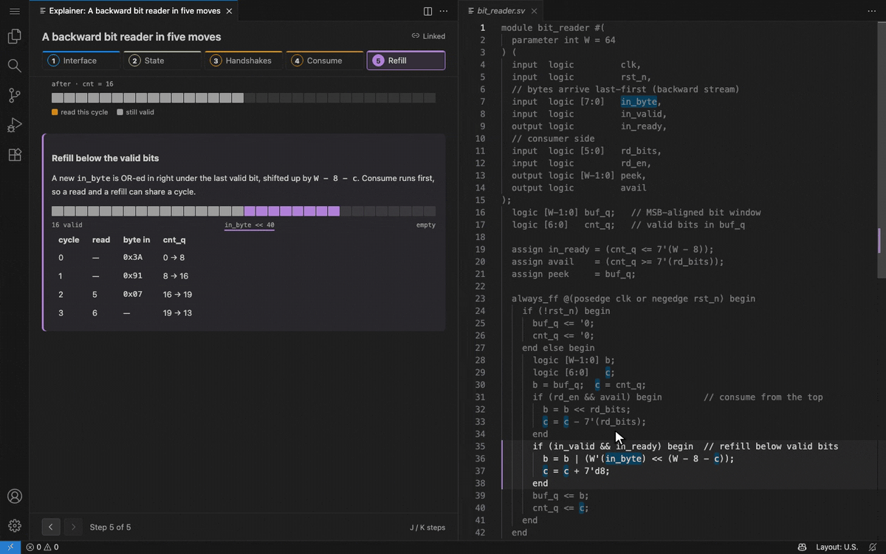

# Sidestory

**Rich explainers beside your code: diagrams, live widgets and prose that walk through the code with you, and that you or your AI agent can write.**


An explainer is an HTML page in your repository (`.explain/<name>/`) whose sections are pinned to the code they describe. Sidestory opens it beside the editor and keeps the two in step: diagrams, tables, block diagrams and interactive React widgets on one side, the real code, highlighted, on the other. Great for onboarding, design reviews, hardware (RTL) walkthroughs and anything too big for comments.

> **Preview.** Sidestory is new; feedback and bug reports are welcome on [GitHub](https://github.com/mozru/sidestory/issues).

## Linked both ways

Step through the explainer (arrow buttons, <kbd>J</kbd>/<kbd>K</kbd>, or <kbd>Alt</kbd>+<kbd>]</kbd> / <kbd>Alt</kbd>+<kbd>[</kbd> anywhere) and the editor scrolls to the code each section is about, highlights it and marks the identifiers that matter. Move the cursor in the code and the explainer jumps to the section about it. Links in the text and blocks in a diagram show their code when clicked.


## Diagrams and live widgets

Explainers are free-form HTML and CSS, so they can hold anything a page can: inline SVG block diagrams, tables, tabs, steppers and quizzes, all in your VS Code theme. For what CSS can't do, add **widgets**: React components written the way Claude writes artifacts (Tailwind, shadcn/ui-style components, Recharts, D3, Motion), each in its own sandboxed frame. A widget knows the current step, can read the code its explainer points at, and highlights lines in the editor as it runs.


## Big systems: an overview, then the details

Write one explainer per piece and an overview that ties them together. Readers skip a piece, **peek** at its one-line summary in place, or **dive** into its own explainer in the same panel, with a trail at the top to come back to the step they left. Details can have details of their own.


## Stays in sync with the code

Sections are anchored to the code they describe, not just to line numbers. Insert lines above, move a function, or edit the code (saved or not) and the section follows it as you type. When the code itself changes, the section says so: **Code changed**, **Out of date** when it changed a lot, or **Code not found**. **Sidestory: Pin Anchors to the Current Code** records each anchor's code; **Re-anchor Section to Selection** points a section at new code. Edits to the explainer show up live too, keeping your place.



## Write them with any AI agent

Explainers are plain files: `explainer.html`, `manifest.json` and optional widget `.tsx` files. Claude Code, Codex or any other agent (or you) can write them, and a checker that ships with the extension catches mistakes without running anything: problems appear in the Problems panel as you save, **Sidestory: Check Widgets** checks on demand, and a command-line checker serves agents in a terminal.


## Safe by default

Explainers are content from the repository, so Sidestory treats them like untrusted input. The page itself can't run script, reach the network or read files outside the repository, which is why it works in **Restricted Mode**. Widgets are code, so they run only in trusted workspaces, only with the `sidestory.widgets.enabled` user setting on, and only after you agree in a VS Code dialog that says what they can do. Until then you see each widget's fallback. Details: [SECURITY.md](SECURITY.md).


## Quick start

### 1. Install

Install **Sidestory** from the [Visual Studio Marketplace](https://marketplace.visualstudio.com/items?itemName=paperkite.sidestory), or run:

```bash
code --install-extension paperkite.sidestory
```

### 2. Open an example

Clone [the repository](https://github.com/mozru/sidestory) and open the [`examples/stream-dma`](examples/stream-dma) folder in VS Code: a memory-to-memory DMA engine in eight SystemVerilog modules, with an overview and an explainer per block. Run **Sidestory: Open Explainer** from the Command Palette and pick **dma-overview**. The smaller [`fixtures/sample-workspace`](fixtures/sample-workspace) has a bit reader and a retry loop.

### 3. Write your first explainer

An explainer is a folder under `.explain/` in your repository; file paths in its manifest are relative to the folder that contains `.explain/`. Mark each section with `data-explain-anchor` and say in `manifest.json` which code it is about.

`.explain/retry/explainer.html`:

```html
<section data-explain-anchor="delay" data-explain-title="Delay">
  <h2>How long to wait</h2>
  <p>The ceiling doubles every attempt until <code>maxMs</code>; the wait is a random point below it.</p>
</section>

<section data-explain-anchor="loop" data-explain-title="The loop">
  <h2>The loop</h2>
  <p>Try, and on failure sleep for <a data-explain-ref="delay">the delay</a> before the next attempt.</p>
</section>
```

`.explain/retry/manifest.json`:

```json
{
  "version": 1,
  "title": "Retry with full-jitter backoff",
  "summary": "Why retries wait a random, growing time.",
  "anchors": {
    "delay": { "file": "src/retry.ts", "range": [14, 18], "highlight": ["ceiling"], "color": "charts.blue" },
    "loop": { "file": "src/retry.ts", "range": [20, 30], "color": "charts.green" }
  }
}
```

Open it with **Sidestory: Open Explainer**, then run **Sidestory: Pin Anchors to the Current Code** so the anchors follow the code through edits. The [guide](docs/GUIDE.md) covers every attribute, the manifest, overviews and details, styling and limits.

### 4. Or ask your agent

**Claude Code** learns Sidestory from a plugin. Install it once:

```text
/plugin marketplace add mozru/sidestory
/plugin install sidestory@sidestory
```

Then ask in plain words, for example *"Explain how the DMA controller works, with Sidestory."* Claude reads the guides bundled in the plugin, writes the explainer, runs the checker and pins the anchors.

**Codex** and other agents that support [Agent Skills](https://agentskills.io) can use the same skill: copy [`plugins/sidestory/skills/sidestory`](plugins/sidestory/skills/sidestory) into the agent's skills folder (for Codex, `~/.codex/skills/sidestory`).

Any other agent: point it at the guides, for example:

> Write a Sidestory explainer for `rtl/dma_ctrl.sv` in `.explain/dma-ctrl/`: a section per part of the FSM, an SVG state diagram, and a widget that steps through a transfer. Follow https://github.com/mozru/sidestory/blob/main/docs/GUIDE.md and https://github.com/mozru/sidestory/blob/main/docs/WIDGETS.md, then run the checker until it reports no errors.

The checker ships with the extension; **Sidestory: Copy Widget Check Command** copies the exact command for your machine. It looks like:

```bash
node "$(ls ~/.vscode*/extensions/*sidestory*/dist/check.cjs | tail -n 1)" .explain/dma-ctrl
```

Add `--pin` to pin anchors from the files on disk, or `--json` for a machine-readable report.

## Commands

| Command | What it does |
|---|---|
| **Sidestory: Open Explainer** | Pick an explainer in `.explain/` and open it beside the code (also on a folder's context menu in the Explorer). |
| **Sidestory: Next Step** / **Previous Step** | Move through the explainer (<kbd>Alt</kbd>+<kbd>]</kbd> / <kbd>Alt</kbd>+<kbd>[</kbd>; <kbd>J</kbd>/<kbd>K</kbd> in the panel). |
| **Sidestory: Pin Anchors to the Current Code** | Record each anchor's code so sections follow it through edits and say when it changed. |
| **Sidestory: Re-anchor Section to Selection** | Point a section at the selected code (also in the editor's context menu). |
| **Sidestory: Check Widgets** | Check the open explainer's widgets now; results go to the Problems panel. |
| **Sidestory: Copy Widget Check Command** | Copy the command-line checker's command for this machine, for agents and scripts. |
| **Sidestory: Add Widget Types** | Write type declarations so `tsc` and IntelliSense work on widget files. |
| **Sidestory: Enable Widgets** | Turn widgets back on after the watchdog stopped one (and the setting, if it's off). |
| **Sidestory: Revoke Widget Consent** | Forget that you agreed to run this workspace's widgets. |

## Settings

| Setting | Default | |
|---|---|---|
| `sidestory.dimUnfocused` | `true` | Fade the rest of the file while you step through an explainer (never in high contrast themes). |
| `sidestory.widgets.enabled` | `true` | Run interactive widgets; each workspace still asks first. A user setting: a repository's settings can't turn it on. In browser VS Code, set it in the **User** tab of the Settings editor. |

## Requirements

- VS Code 1.95 or later.
- Works locally and over Remote-SSH, WSL, Dev Containers, Codespaces and browser VS Code backed by a server (code-server, openvscode-server, `code tunnel`). Not on vscode.dev or github.dev alone, which have no server to run it.
- Nothing else to install: widget libraries ship with the extension.

## Learn more

- [Guide](docs/GUIDE.md): writing explainers, the manifest, overviews and details, anchor states, styling, what's supported, limits, troubleshooting, development.
- [Writing widgets](docs/WIDGETS.md): the widget contract, imports, theming, linking to code, checking, and a gallery. Written for people and for agents.
- [Security](SECURITY.md): the threat model and what widgets can and can't reach.
- [Changelog](CHANGELOG.md)
- [The stream DMA example](examples/stream-dma)

## License

[MIT](LICENSE)
