# Sidestory

**Explain your code in a page that sits beside it, with diagrams, live widgets and prose that move with you as you read. You can write one yourself or have your AI agent write it.**

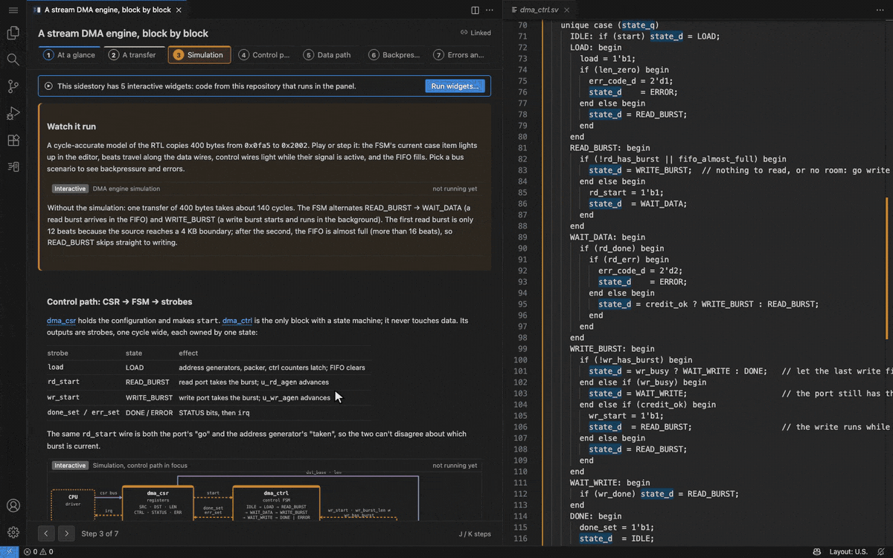

A sidestory is an HTML page that lives in your repo, under `.sidestory/<name>/`. Each section is pinned to the code it talks about. Sidestory opens the page next to your editor and keeps the two in step. It's made for onboarding, design reviews, hardware (RTL) walkthroughs, and anything else that's too big to explain in a comment.

> **Preview.** Sidestory is new. Feedback and bug reports are welcome on [GitHub](https://github.com/mozru/sidestory/issues).

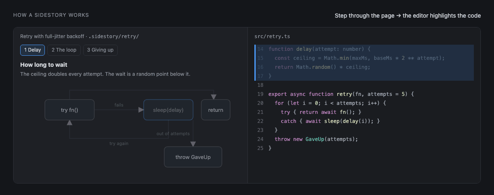

## Quick start

**1. Install** from the [Marketplace](https://marketplace.visualstudio.com/items?itemName=paperkite.sidestory), or run:

```bash
code --install-extension paperkite.sidestory
```

You need VS Code 1.95 or later. It works locally and over Remote-SSH, WSL, Dev Containers, Codespaces and server-backed browser VS Code (code-server, openvscode-server, `code tunnel`). It doesn't work on vscode.dev or github.dev alone. There's nothing else to install, since the widget libraries ship with the extension.

**2. Try an example.** Clone [the repo](https://github.com/mozru/sidestory) and open one of these folders. Then run **Sidestory: Open Sidestory…** and pick the overview.

| Folder | What it explains | Open |
|---|---|---|
| [`examples/stream-dma`](examples/stream-dma) | A DMA engine in eight SystemVerilog modules | **dma-overview** |
| [`examples/tiny-lsm`](examples/tiny-lsm) | A log-structured merge-tree store in Python | **lsm-overview** |
| [`fixtures/sample-workspace`](fixtures/sample-workspace) | A bit reader and a retry loop (small) | any |

**3. Write your own**, or ask your agent to (see [below](#let-your-ai-agent-write-them)).

## Reading a sidestory

Step through with the arrow buttons, <kbd>J</kbd>/<kbd>K</kbd> in the panel, or <kbd>Alt</kbd>+<kbd>]</kbd> / <kbd>Alt</kbd>+<kbd>[</kbd> from anywhere (<kbd>Ctrl</kbd>+<kbd>Option</kbd>+<kbd>]</kbd> / <kbd>[</kbd> on macOS). The editor scrolls to each step's code, highlights it, and marks the names that matter. It works the other way too. Click in the code, and the diagram boxes for that code light up and the page moves to the step about it.

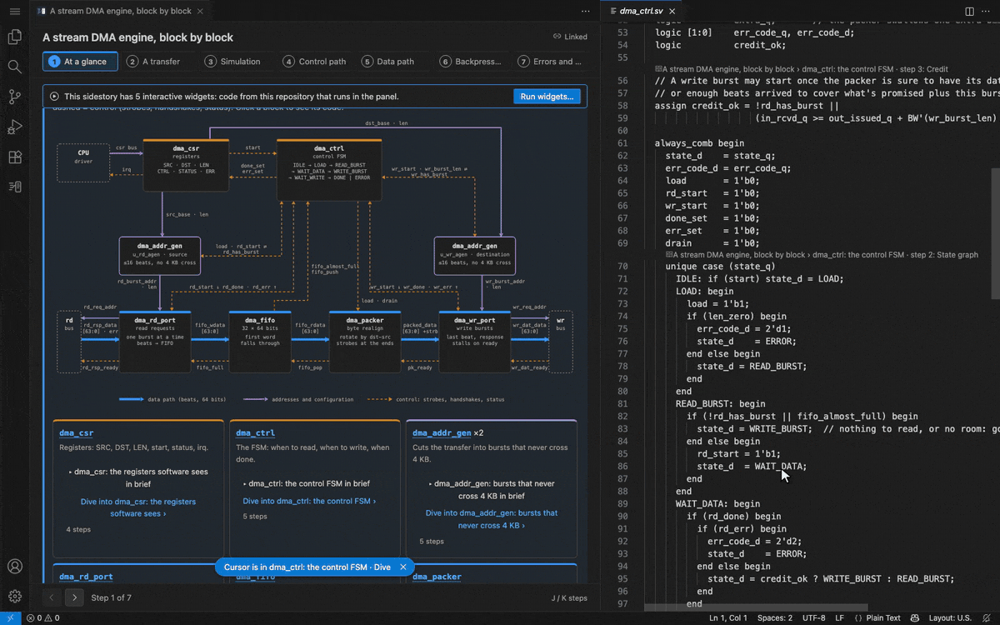

Big systems get an overview plus one sidestory per piece. From the overview you can **peek** at a piece's one-line summary, or **dive** into its own sidestory. A trail at the top takes you back to where you were.

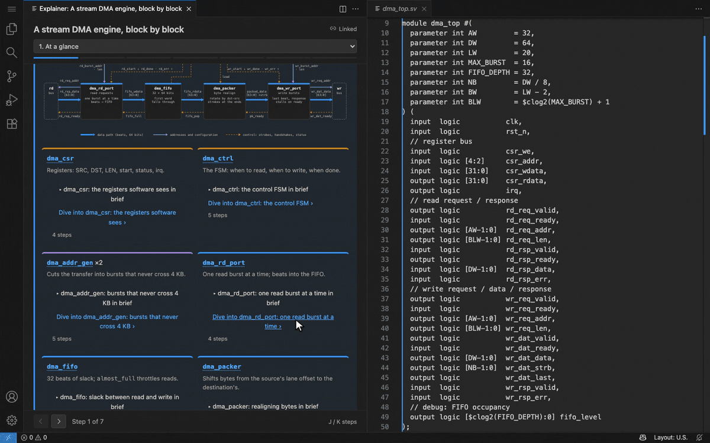

There are a few ways to find what's been explained:

- The **Sidestory icon** in the activity bar lists every sidestory, with overviews first (**Start here**) and their details under them.
- A **CodeLens** above explained code names the sidestory and step. Click it to open the page right there.
- **Sidestory: Go to Step…** searches every step by title.

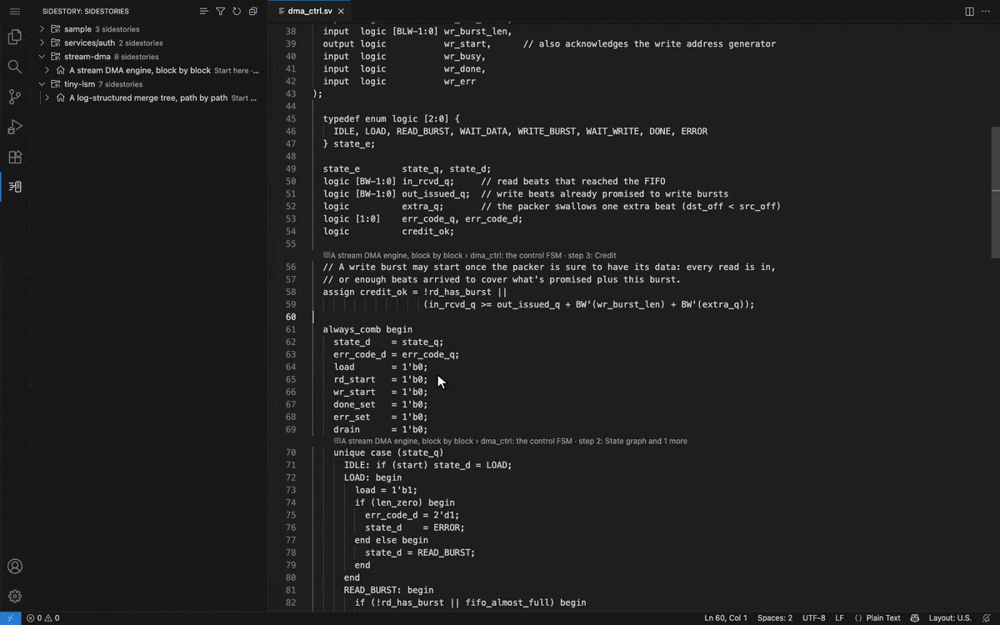

## What a page can hold

A sidestory is free-form HTML and CSS, styled in your VS Code theme. It can hold almost anything a static page can, like tables, tabs, steppers and quizzes, plus some extras.

**Diagrams that follow along.** Block diagrams are plain inline SVG. Tag a box with `data-explain-on="datapath"` and it lights up on that step while the rest fades. A box with `data-explain-code` opens its code when clicked, and glows while your cursor is in it. For SystemVerilog it can name a signal instead of lines, such as `#driver(state_q)`.

**Motion.** CSS and SVG animation (`<animate>`, `<animateMotion>`) play in the panel, so a beat can travel the wire the current step lights, or a FIFO can fill. SVG animation stops for readers who ask for less motion. See [Moving parts](docs/GUIDE.md#moving-parts).

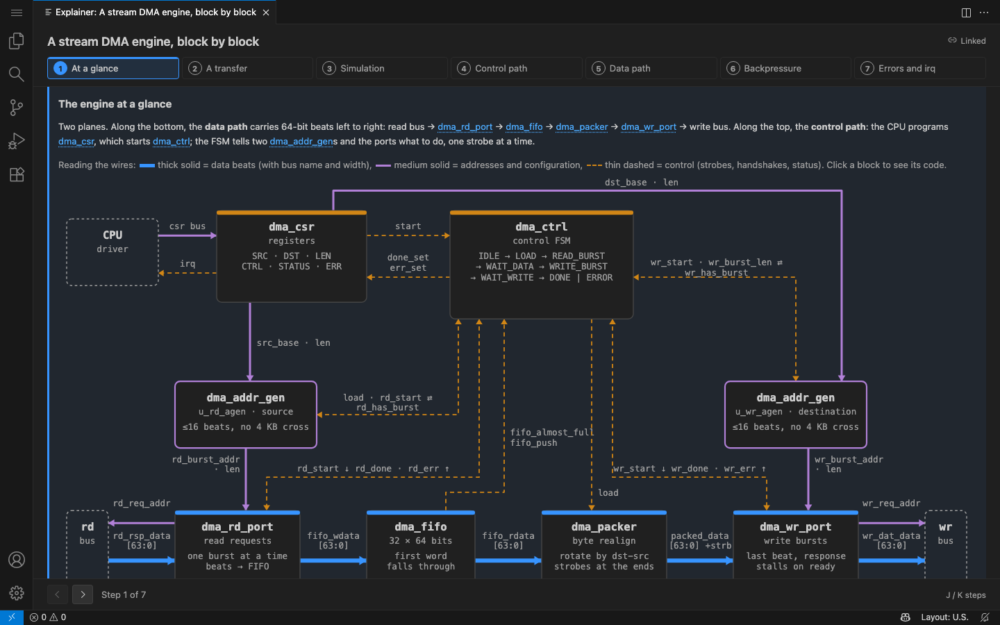

**Live widgets.** For what CSS can't do, add a React component. Each one runs in its own sandboxed frame and is written the way Claude writes artifacts (Tailwind, shadcn/ui-style components, Recharts, D3, Motion). A widget knows the current step, can read the code the page points at, and can highlight lines in the editor as it runs.

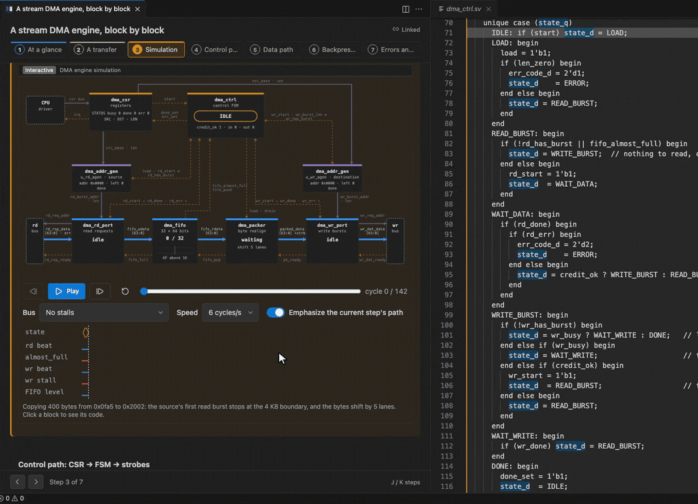

**Any language.** Code blocks are highlighted in your editor's theme, using the language extensions you already have. Anchors work in any language.

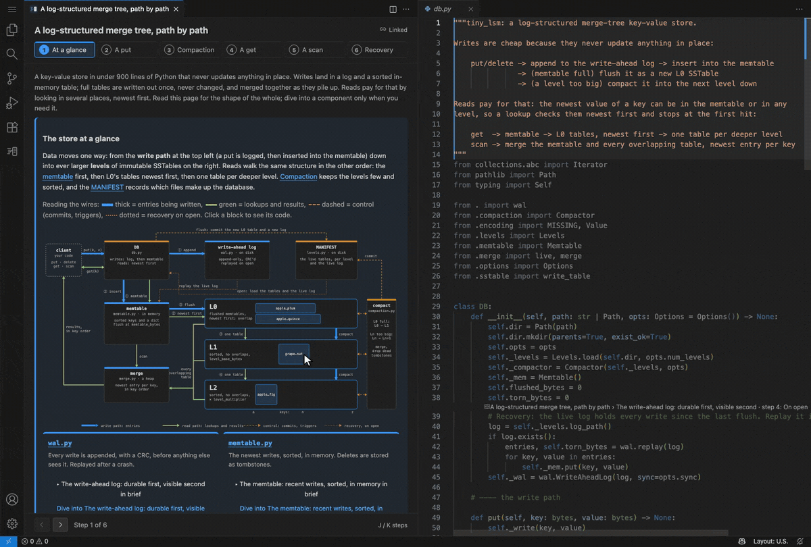

## It keeps up with the code

Sections are tied to the code itself, not to line numbers. They follow it as you type, saved or not. When the code really changes, the section tells you.

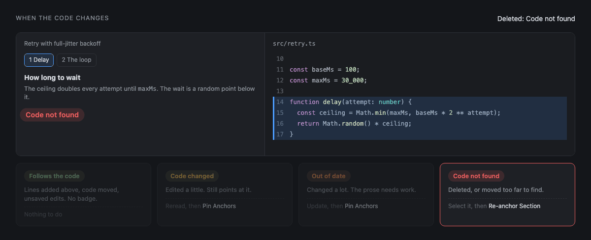

**Sidestory: Pin Anchors to the Current Code** records the code each section is about, and **Sidestory: Re-anchor Section to Selection** points a section at different code. Edits to the page itself also show up live, without losing your place.

## Let your AI agent write them

A sidestory is just plain files: `sidestory.html`, `manifest.json`, and optional widget `.tsx` files. Any agent can write them.

**Claude Code.** Install the plugin once:

```text
/plugin marketplace add mozru/sidestory
/plugin install sidestory@sidestory
```

Then ask, for example *"Explain how the DMA controller works, with Sidestory."* Claude reads the guides that come with the plugin, writes the page, checks it and pins the anchors.

**Codex** and other agents that support [Agent Skills](https://agentskills.io): copy [`plugins/sidestory/skills/sidestory`](plugins/sidestory/skills/sidestory) into the agent's skills folder (`~/.codex/skills/sidestory` for Codex).

For any other agent, run **Sidestory: Copy a Prompt for Your Agent**, fill in the code and a name, and paste it in.

A checker ships with the extension and catches mistakes without running anything. Problems appear in the Problems panel when you save. Agents in a terminal can use the command-line version, and **Sidestory: Copy Widget Check Command** copies the exact command for your machine. It looks like this:

```bash
node "$(ls ~/.vscode*/extensions/*sidestory*/dist/check.cjs | sort -V | tail -n 1)" .sidestory/dma-ctrl
```

Add `--pin` to pin anchors, or `--json` for output a script can read.

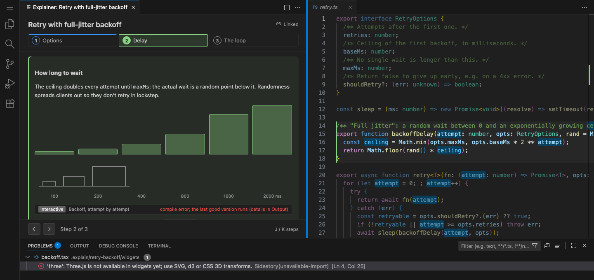

## Writing one by hand

Mark each section with `data-explain-anchor`, and say in `manifest.json` which code it's about. File paths are relative to the folder that contains `.sidestory/`.

`.sidestory/retry/sidestory.html`:

```html
<section data-explain-anchor="delay" data-explain-title="Delay">
  <h2>How long to wait</h2>
  <p>The ceiling doubles every attempt until <code>maxMs</code>; the wait is a random point below it.</p>
</section>

<section data-explain-anchor="loop" data-explain-title="The loop">
  <h2>The loop</h2>
  <p>Try, and on failure sleep for <a data-explain-ref="delay">the delay</a> before the next attempt.</p>
</section>
```

`.sidestory/retry/manifest.json`:

```json
{
  "version": 1,
  "title": "Retry with full-jitter backoff",
  "summary": "Why retries wait a random, growing time.",
  "anchors": {
    "delay": { "file": "src/retry.ts", "range": [14, 18], "highlight": ["ceiling"], "color": "charts.blue" },
    "loop": { "file": "src/retry.ts", "range": [20, 30], "color": "charts.green" }
  }
}
```

Open it with **Sidestory: Open Sidestory…**, then run **Sidestory: Pin Anchors to the Current Code**. The [guide](docs/GUIDE.md) covers every attribute, overviews and details, styling and limits. [WIDGETS.md](docs/WIDGETS.md) covers widgets.

## Explaining a branch

Add a `"base"` to a sidestory's manifest and it explains a branch: its steps cover the branch's changes against that base. Keep browsing the diff in the tool you already use. [Git Tree Compare](https://marketplace.visualstudio.com/items?itemName=letmaik.git-tree-compare) works best, and GitLens and Source Control work too. Sidestory adds badges that show which changes have a step.

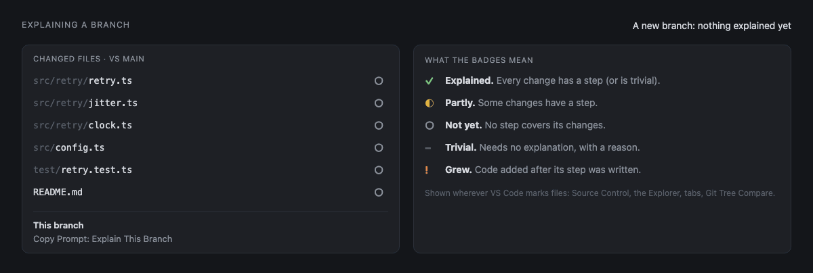

- **This branch**, at the top of the Sidestories view, shows the totals. If nothing explains the branch yet, **Copy Prompt: Explain This Branch** gives you a prompt for your agent.
- **Steps open the file itself**, with the step's lines highlighted. **Open Changes with Base**, in the editor title bar, switches to the diff at the same spot. To start in the diff instead, set `sidestory.changes.openStepsIn` to `"diff"`.
- Right-click a change for **Copy Prompt: Explain This Change**, **Mark as Trivial…** (it asks why), or **Re-pin This Step** once you've updated a step whose code grew.
- **Sidestory: Next Unexplained Change** (<kbd>Ctrl</kbd>+<kbd>Alt</kbd>+<kbd>Shift</kbd>+<kbd>PageDown</kbd>, or <kbd>Ctrl</kbd>+<kbd>Cmd</kbd>+<kbd>Shift</kbd>+<kbd>Down</kbd> on macOS) walks through what's left. **Sidestory: Next Changed File** drops the <kbd>Shift</kbd>.

To pick the base yourself, run **Sidestory: Set Base…**. Otherwise Sidestory uses the `base` of a sidestory added on this branch, then Git's recorded base, `sidestory.changes.defaultBase`, the remote's default branch, and finally `main` or `master`. Narrow diffs switch to inline view, which hides removed code. To keep them side by side, set `"diffEditor.useInlineViewWhenSpaceIsLimited": false`. There's more in the [guide](docs/GUIDE.md#explaining-a-branch).

## Comments, and Ask Claude

Comment on a step (<kbd>C</kbd> in the panel) or on code (**Sidestory: Comment on Selection**, or the gutter **+**). Threads stay on your machine in `.sidestory/.local/`, which git ignores, until you **Share** one. Sharing commits it with the sidestory.

**Ask Claude** (<kbd>A</kbd>) sends your comment to a running Claude Code session, and Claude replies in the thread. To set it up, run `/plugin install sidestory-comments@sidestory`, then start Claude with the command that **Sidestory: Copy Claude Command with Comments** copies. For Codex, Cursor and other MCP clients, use **Sidestory: Copy MCP Server Config**. There's more in [Comments and Claude](docs/GUIDE.md#comments-and-claude).

## Safe by default

Sidestory treats every page as untrusted input. A page can't run script, reach the network or read files outside the repo, so it works even in **Restricted Mode**. Widgets are code, so they only run when three things are true:

1. The workspace is trusted.
2. The `sidestory.widgets.enabled` user setting is on.
3. You've agreed in a dialog that says what they can do.

Until then, you see each widget's static fallback. The full threat model is in [SECURITY.md](SECURITY.md).

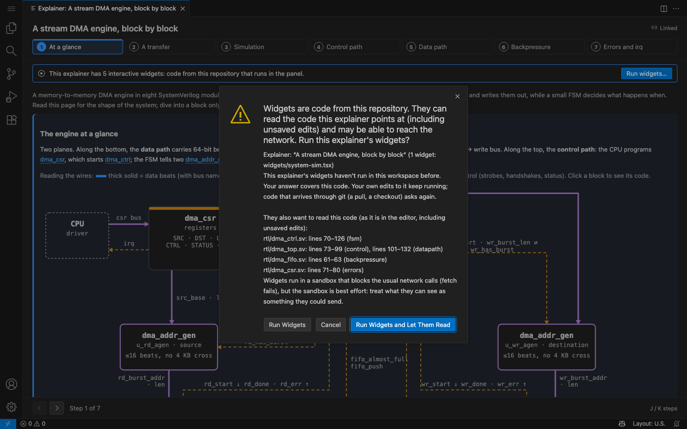

## Commands

These are the commands you'll use most. They're all in the Command Palette.

| Command | What it does |
|---|---|
| **Sidestory: Open Sidestory…** | Pick a sidestory and open it beside the code. |
| **Sidestory: Go to Step…** | Find any step by its title. |
| **Sidestory: Next Step** / **Previous Step** | Move through the page (<kbd>Alt</kbd>+<kbd>]</kbd> / <kbd>[</kbd>). |
| **Sidestory: Show Sidestories for This Code** | List the pages that explain the code under the cursor. |
| **Sidestory: Copy a Prompt for Your Agent** | Copy a prompt that asks your agent to write a sidestory. |
| **Sidestory: Pin Anchors to the Current Code** | Record each section's code, so it can follow edits. |
| **Sidestory: Re-anchor Section to Selection** | Point a section at the selected code. |
| **Sidestory: Check Widgets** | Check the open page's widgets now. |
| **Sidestory: Comment on Selection** / **Ask Claude About Selection** | Comment on lines, or ask Claude about them. |
| **Sidestory: Set Base…** | Choose the branch to compare with. |
| **Sidestory: Revoke Widget Consent** | Forget that you agreed to run this workspace's widgets. |

## Settings

Here are the settings people change most. The [guide](docs/GUIDE.md#settings) lists all of them.

| Setting | Default | |
|---|---|---|
| `sidestory.dimUnfocused` | `true` | Fade the rest of the file while you step through. |
| `sidestory.codeLens.enabled` | `true` | Show a CodeLens above explained code. |
| `sidestory.clickHighlightSeconds` | `1.5` | How long the code stays lit after you click a code link. `0` keeps it lit until the next one. |
| `sidestory.gutter.enabled` | `false` | Show a book icon in the gutter on explained code. |
| `sidestory.changes.openStepsIn` | `"editor"` | Open a branch's steps in the file, or in the diff. |
| `sidestory.changes.includeUncommitted` | `true` | Count uncommitted changes in coverage. Turn it off to see what CI sees. |
| `sidestory.comments.defaultLocation` | `"local"` | Keep new threads `local` or `shared` (committed). |
| `sidestory.widgets.enabled` | `true` | Run widgets. Each workspace still asks first, and only your user settings count. |

## Learn more

- [Guide](docs/GUIDE.md): writing sidestories, the manifest, anchors, styling, branches, troubleshooting
- [Writing widgets](docs/WIDGETS.md): the widget contract, imports, theming, and a gallery
- [Security](SECURITY.md) · [Changelog](CHANGELOG.md) · [MIT License](LICENSE)
