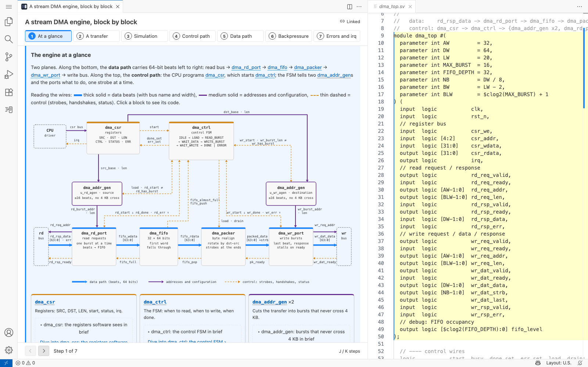
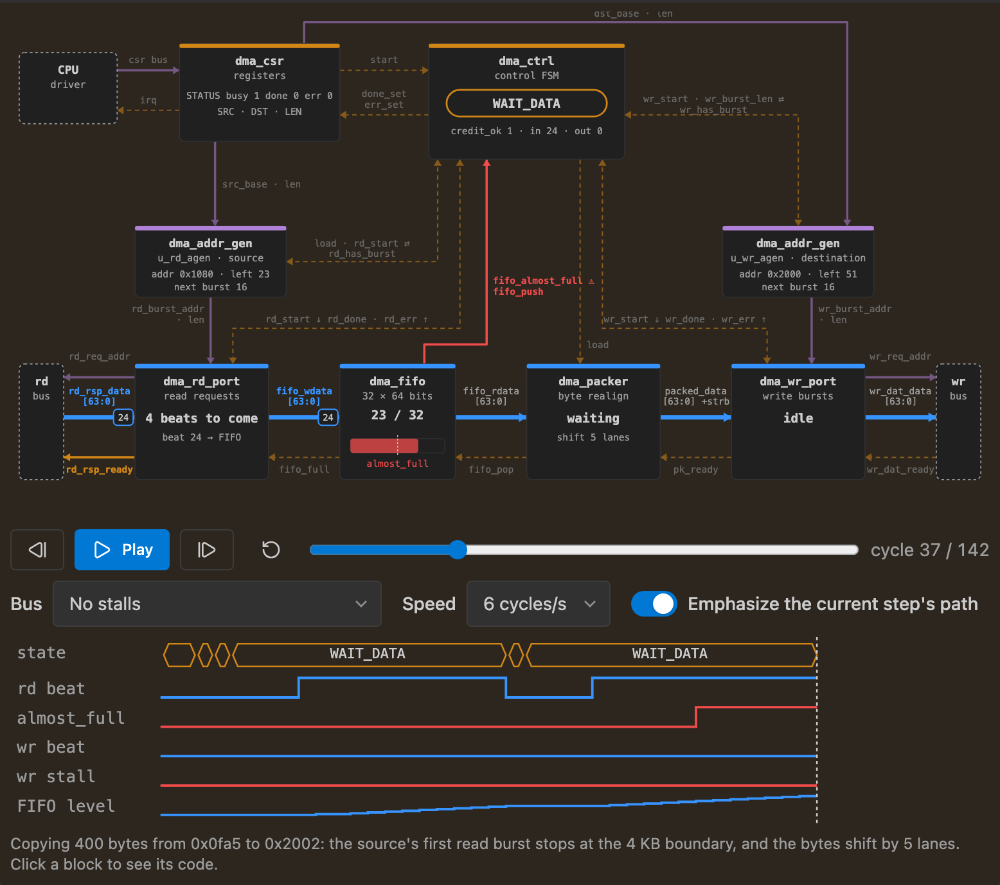

# Sidestory guide

The full reference for writing and reading sidestories. For a quick tour, see the [README](../README.md); for widgets, [WIDGETS.md](WIDGETS.md); for the security model, [SECURITY.md](../SECURITY.md).

## Contents

- [Where it runs](#where-it-runs)
- [Reading a sidestory](#reading-a-sidestory)
- [Writing a sidestory](#writing-a-sidestory)
  - [Link sections to code](#link-sections-to-code)
  - [The manifest](#the-manifest)
  - [Big systems: an overview with details](#big-systems-an-overview-with-details)
  - [Diagrams that follow the steps](#diagrams-that-follow-the-steps)
  - [Code links without an anchor](#code-links-without-an-anchor)
  - [How sections follow the code](#how-sections-follow-the-code)
  - [Styling](#styling)
  - [What's supported, and what's removed](#whats-supported-and-whats-removed)
  - [Interactive widgets](#interactive-widgets)
- [Explaining a branch](#explaining-a-branch)
  - [Base, side and trivial marks](#base-side-and-trivial-marks)
  - [The coverage rule](#the-coverage-rule)
  - [Which sidestories count](#which-sidestories-count)
  - [Coverage in VS Code](#coverage-in-vs-code)
  - [Checking coverage](#checking-coverage)
  - [Coverage in CI](#coverage-in-ci)
- [Settings](#settings)
- [Troubleshooting](#troubleshooting)
- [Development](#development)

## Where it runs

- **Locally and remotely:** Remote-SSH, WSL, Dev Containers, Codespaces, and browser VS Code backed by a server (code-server, openvscode-server, `code tunnel`). Not on vscode.dev or github.dev alone, which have no server to run it.
- **In Restricted Mode.** Sidestory content can't run script, reach the network or read files outside the repository, so untrusted repositories are safe to read. Widgets never run there. See [SECURITY.md](../SECURITY.md).
- **In every theme**, including high contrast: colors, fonts and focus come from your VS Code theme.



## Reading a sidestory

Open one with **Sidestory: Open Sidestory** from the Command Palette, or right-click a folder under `.sidestory/` in the Explorer.

- **Step through the sidestory** and the editor shows and highlights the code each section is about. Step with the arrow buttons, <kbd>J</kbd>/<kbd>K</kbd> in the panel, or <kbd>Alt</kbd>+<kbd>]</kbd> / <kbd>Alt</kbd>+<kbd>[</kbd> anywhere (<kbd>Ctrl</kbd>+<kbd>Option</kbd>+<kbd>]</kbd> / <kbd>[</kbd> on macOS, where <kbd>Option</kbd>+<kbd>]</kbd> types a quote).
- **Move your cursor in the code** and the sidestory jumps to the section about it. Boxes and links that point at the code under the cursor get a ring, wherever they are in the page; only code a section covers changes the step.
- **Everything updates live.** Edit the code (saved or not) or the sidestory and the panel follows at once, keeping your place, your focus and anything you're typing. Sections follow code that moves, and tell you when the code changed, needs a look, or can't be found.

## Writing a sidestory

A sidestory is a folder in your repository:

```
.sidestory/
  bit-reader/
    sidestory.html   the page: any HTML and CSS
    manifest.json    which code each section is about
    assets/          optional: images, fonts, stylesheets
```

Open it with **Sidestory: Open Sidestory**.

### Link sections to code

Mark any element that is about some code with `data-explain-anchor`, and name it in the manifest:

```html
<section data-explain-anchor="refill" data-explain-title="Refill">
  <h2>Refill below the valid bits</h2>
  … anything …
</section>
```

- Top-level anchored elements become the steps in the navigator. Nested anchored elements (a figure inside a section) are linked too, but aren't steps.
- `data-explain-title` sets the step's short label; otherwise the first heading is used.
- `<a data-explain-ref="state">peek</a>` jumps the editor to another anchor's code when clicked, without changing the current step.
- `--cx-accent` is set on each anchored element to its color, so your CSS can use `var(--cx-accent)`.

#### Links on any element, diagram boxes included

`data-explain-ref` works on any element, not just `<a>`: a word in the text, a table row, a card, or a box or wire in an inline SVG. Readers click it, or Tab to it and press <kbd>Enter</kbd>, and the editor jumps to that code. For a block diagram, put it on each block's `<g>`:

```html
<svg viewBox="0 0 400 120" role="group" aria-label="The FIFO between the read and write ports">
  <g data-explain-ref="fifo">
    <title>dma_fifo: show its code</title>
    <rect x="150" y="20" width="100" height="60" rx="6" fill="var(--cx-box-fill)" stroke="var(--cx-box-stroke)"/>
    <text x="200" y="55" text-anchor="middle" fill="var(--cx-box-text)">dma_fifo</text>
  </g>
</svg>
```

Linked elements look the same in every sidestory, and your own CSS always wins over this:

| Linked element | At rest | Hover | Keyboard focus |
|---|---|---|---|
| Text (`a`, `span`, `code`, `b`, `strong`, `em`, `i`, `abbr`, `kbd`, `var`, `samp`) | link color, dotted underline | the active link color | a thin ring |
| Any other HTML element (`div`, `li`, `td`, `figure`, `img`) | unchanged, pointer cursor | an outline | a thicker ring |
| Anything inside an `<svg>` | unchanged, pointer cursor: its colors, `currentColor` and `<text>` stay as you drew them | a soft glow around its shape | a ring |

- Set `--cx-link-hover` or `--cx-link-ring` to `transparent` to turn that effect off, or to another color.
- `data-explain-plain` on a linked element removes the built-in look (only the pointer cursor stays), for a link you style yourself.
- A reader opens a link by clicking it, or by tabbing to it and pressing <kbd>Enter</kbd> (not <kbd>Space</kbd>, which scrolls).
- **Give a diagram with links `role="group"` and an `aria-label`**, not `role="img"`: screen readers don't see the children of an image, so its links would be out of their reach. Give each linked `<g>` a name with a `<title>` (which is also a tooltip) or an `aria-label`.
- Links on form controls (`button`, `input`, `select`, `textarea`, `meter`, `output`, `progress`) or on a widget are ignored, and so are clicks on a control or widget inside a link: those clicks are for the control. Output says so.

### The manifest

```json
{
  "version": 1,
  "title": "A backward bit reader in five moves",
  "anchors": {
    "refill": {
      "file": "rtl/bit_reader.sv",
      "range": [35, 38],
      "highlight": ["in_byte", "c"],
      "color": "charts.purple"
    }
  }
}
```

| Field | Meaning |
|---|---|
| `file` | Path from the folder that contains `.sidestory/`, with `/` separators. |
| `range` | First and last line (1-based). A hint: the anchor follows the code as it moves. |
| `highlight` | Identifiers to mark everywhere in the file while the section is active. |
| `summary` | Top level, optional: one line shown when a parent sidestory peeks at this one, and in the sidebar and pickers. |
| `group` | Top level, optional: a group name (1–60 characters) to file the sidestory under in the Sidestories view. A grouped sidestory is always listed at the top level, even when another one links to it as a detail. |
| `top` | Top level, optional: `true` keeps a sidestory at the top level of the view without a group, even when another one links to it. |
| `color` | A theme color id, normally one of `charts.blue`, `charts.green`, `charts.yellow`, `charts.orange`, `charts.purple`, `charts.red`. Never a hex value: colors follow the user's theme. |

Then run **Sidestory: Pin Anchors to the Current Code** to record each anchor's exact code and surrounding lines. That upgrades the manifest to `version: 2` with a `quote` per anchor, which is what lets an anchor survive edits, moves and duplicates. Until then a section is just a line range and can't tell when its code changes; the panel says so once per sidestory. Pin edits only the anchors it pins and keeps the rest of `manifest.json` as you wrote it. It pins what the editors show, unsaved changes included, and says when it did.

Pin only pins anchors whose code it finds with confidence. It names each anchor it left alone and why (code changed, out of date, code not found, ambiguous, file missing), then lists the ones it could still pin: where the code is now, and the lines their `range` gives. Tick the ones whose code you changed on purpose to pin them there.

To point a section at different code:

- select the code and run **Sidestory: Re-anchor Section to Selection** (also in the editor's context menu while a sidestory is open), then pick the section; sections whose code is lost or out of date are listed first. The selection may be in another file of the same repository; or
- edit its `range` in the manifest and run Pin: when the recorded code can't be found with confidence, Pin offers the lines `range` gives. (If the recorded code is still there unchanged, Pin follows it instead; use Re-anchor.)

### Big systems: an overview with details

One sidestory per piece, plus an overview that ties them together. In the overview, mark where a piece comes up with the name of its sidestory (a sibling folder in `.sidestory/`):

```html
<section data-explain-anchor="reader">
  <h2>The bit reader</h2>
  <p>Bytes arrive last-first; it hands out bits on demand.</p>
  <div data-explain-detail="bit-reader"></div>
</section>
```

Readers then choose, per piece:

- **Skip**: just read on; the overview stands on its own.
- **Peek**: "*Title* in brief" opens the detail's `summary` in place.
- **Dive**: "Dive into *Title*" shows the detail sidestory in the same panel. A trail at the top shows the way back; **Back**, a trail entry or <kbd>Esc</kbd> returns to the step you left.

Details can have details of their own (up to 16 levels). Give each sidestory a one-line `summary` in its manifest for the peek. When the editor cursor is in code a detail covers but the sidestory you're reading doesn't, the panel offers to dive into it.

### Finding your way in big repositories

The **Sidestories** view (the Sidestory icon in the activity bar, shown once a workspace has sidestories, or with **Sidestory: Show Sidestories**) lists every sidestory:

- **Packages.** Each `.sidestory/` folder is a package: `services/auth/.sidestory/` and `services/billing/.sidestory/` are listed apart, and each one's anchor paths are relative to the folder that holds it. Detail links stay inside one `.sidestory/` folder. A `.sidestory/` inside another sidestory is ignored.
- **Start here.** In each package, a sidestory named `overview`, else the only one named `*-overview`, else the only top-level sidestory with details, is pinned first.
- **Tops and details.** A sidestory nothing links to is listed at the top level, with the details it links to nested under it in the order the page links them. A detail linked from several places appears under each. Use `group` to file top-level sidestories in folders, or `top: true` to keep a linked sidestory at the top level.
- **Filter** (the funnel in the view's title bar) matches titles, names, summaries and groups, and shows each match once, under its shortest path from a top-level sidestory.
- **Explained here.** A CodeLens above code that a sidestory explains names it and its step ("Overview › Detail · step 3: Title"); click it to open the sidestory there. The status bar names the sidestory for the cursor's line. **Go to Step…** finds a step by its title in the current package or all of them.

Opening from the view, a CodeLens or a picker reuses a panel that holds nothing you'd lose: the panel you were last reading, if it's under the same top-level sidestory, or a *preview* panel you haven't moved in yet (it says so, with **Keep Open**). **Open in New Panel** in the view always opens another.

Two complete examples in this repository work this way: [`examples/stream-dma`](../examples/stream-dma), a DMA engine in SystemVerilog, and [`examples/tiny-lsm`](../examples/tiny-lsm), a log-structured merge-tree key-value store in Python, each with an overview, a sidestory per component, block diagrams and widgets.

### Diagrams that follow the steps

A block diagram can light up the boxes and wires each step is about, and fade the rest. Tag them with `data-explain-on` and the ids of the anchors they matter in:

```html
<figure data-explain-diagram="step dim-rest">
  <svg viewBox="0 0 1100 610" role="group" aria-label="Block diagram of dma_top">
    <g data-explain-on="datapath backpressure" data-explain-ref="m-fifo">…the FIFO box…</g>
    <g data-explain-on="datapath">…the rd_rsp_data wire…</g>
    <g data-explain-on="control errors">…the start strobe…</g>
    <g data-explain-keep>…the legend…</g>
  </svg>
</figure>
```

- **`data-explain-on="<id> …"`** (space-separated) works on any SVG or HTML element. It's **lit** while one of its ids is the current step, or the nested anchor the reader is on inside that step (a card or figure with its own `data-explain-anchor`, which the reader clicked or the editor cursor reached). A nested anchor adds to what its step lights; it can't narrow it, so to light single boxes from cards, give the step itself nothing to light (as the stream DMA overview's first step does). An empty `data-explain-on=""` marks a part that is never lit.
- **Ids must match anchor ids exactly**, case included. One that matches nothing never lights, without an error, so check them against the manifest.
- **What fades:** while anything in a diagram is lit, the tagged parts that aren't lit fade. A part inside a lit group stays lit. With nothing lit (a step the diagram isn't about), the diagram looks exactly as you drew it.
- **The diagram** is the nearest element with `data-explain-diagram`, or else the outermost `<svg>`. A tagged element outside both (a table row in the text) lights up, and nothing fades around it.
- **`data-explain-diagram` takes these words:**
  - `step` (the default): follows the current step.
  - `section`: always shows the state of the section it's in (that section and the step holding it, never a nested anchor the reader is on), whatever step is current. Use it when a section has its own copy of the diagram (for a long page, where the first copy is off screen by step 5).
  - `dim-rest`: untagged parts fade too, so you tag only what each step is about, not every background wire. It fades everything untagged in the diagram element, HTML included: on a `<figure>`, that's the `<figcaption>` too, unless you mark it `data-explain-keep` or put `data-explain-diagram` on the `<svg>`.
- **`data-explain-keep`** on an element (a legend, a title) keeps it and everything inside it from fading (unless it sits inside a tagged part that fades: opacity applies to everything inside). Arrowhead markers, gradients, patterns and the rest of `<defs>` never fade, so a lit wire keeps its arrowhead.
- **Lit parts aren't recolored.** Style them yourself with the `.cx-on` class and the `--cx-on` color: `.wire.cx-on path { stroke: var(--cx-on); stroke-width: 3 }` for a tagged `<g class="wire">`. Without such a rule, lit parts look as drawn, and only the fading tells them apart. `--cx-on` is the color of the section the reader is on (a nested anchor's own color, else its step's); a `section` diagram uses its own section's. To pick your own, set `--cx-on` on the diagram element.
- **How to tag a diagram:**
  - put each wire's path, arrowhead and label in one `<g>` and tag the group, so the label fades and lights with its wire;
  - light both ends of every lit wire, and the block that drives each signal the step's text names;
  - add a box's own anchor id to its list (`data-explain-on="datapath m-fifo"`), so it lights while the reader is on its card or nested section.
- **Fading** is `opacity: var(--cx-dim-opacity)` (0.28 in dark themes, 0.4 in light ones) on the class `cx-dim`, with a short transition (none for readers who asked for reduced motion). Override `.cx-dim` to fade differently.
- **High contrast:** nothing fades; lit HTML elements get a dashed outline, and lit SVG shapes a halo, in the theme's contrast color. Your `.cx-on` rule matters most here.
- **Hover:** the diagram follows the steps, not the pointer. For a hover preview, write it with `:has()`: `.cx-content:has([data-explain-ref~="m-fifo"]:hover) [data-explain-on~="datapath"] { … }`.

The stream DMA overview ([`examples/stream-dma`](../examples/stream-dma)) works this way: one diagram at the top that follows the steps, and a copy with `data-explain-diagram="section dim-rest"` in the fallbacks of the simulation widgets, for readers who don't run widgets.

### Code links without an anchor

A box in a diagram often deserves a link to its code without a manifest entry or a step of its own. `data-explain-code` opens a file, some lines or a symbol:

```html
<figure data-explain-diagram data-explain-code-file="rtl/gemm_row_dispatch.sv">
  <svg …>
    <g data-explain-code="#u_order_fifo">…</g>                 <!-- the file from data-explain-code-file -->
    <g data-explain-code="#driver(order_q)">…</g>
    <g data-explain-code="rtl/dma_fifo.sv#L34-L39">…</g>         <!-- its own file -->
  </svg>
</figure>
<a data-explain-code="rtl/dma_csr.sv">dma_csr.sv</a>
```

- **The path**, before `#`, is from the folder that holds `.sidestory/`, as a manifest `file` is, with `/` separators. It is **not** relative to the page. An empty path takes the nearest `data-explain-code-file` around the element, so a diagram of one module names its file once.
- **After `#`** (optional; without it the file opens at the top):
  - `L10` or `L10-L20`: those lines;
  - a symbol in SystemVerilog or Verilog:
    - a name declared in the file: a signal, port, parameter, typedef or instance (`#order_q`, `#BW`, `#u_ctrl`);
    - what drives a signal: `#driver(state_q)`, the `always` block, `assign` or declaration that assigns it (`#driver(x[7:4])` when blocks drive different slices). `driver()` stays inside one module: a net in a top-level module that only an instance output drives has no driver there, so link the connection or the child's driver (`rtl/dma_ctrl.sv#driver(rd_start)`);
    - one arm of that block's outermost `case`: `#driver(state_d).case(IDLE)`, so each bubble of an FSM diagram opens its own arm. A label found in two `case` statements, or only in a nested one, is ambiguous: link the lines instead;
    - one port connection of an instance: `#u_rd_port(.start)`, where the name in `(.x)` is the instance's port, as in `.start(rd_start)`. That's the link for a wire in a top-level diagram;
    - inside a labelled block or generate block: `#g_lane.driver(lane_q)`.

    Prefix the module (`#dma_ctrl.driver(state_q)`) when a name isn't unique in the file. Only the first arm of each `` `ifdef `` is read, so a name declared only in a later arm isn't found.
  - a symbol in other languages: the names VS Code's outline shows (`#RetryClient.send`), found when the reader clicks (and, for the cursor ring below, in files the reader already has open).
- **The cursor lights it.** With the editor cursor in a link's code, the element gets a ring (`--cx-here`); when several links contain the line, only the tightest does, so the cursor in an FSM's `case` arm rings that bubble, not the whole module. Links to `data-explain-ref` anchors light the same way. This never changes the step: only code a section covers does. Turn it off with `sidestory.followCursorInDiagrams`.
  - When the cursor moves into code a section covers, the step changes. If a box the cursor rings is on screen, the panel stays with the diagram and a pill offers to show the step; otherwise it scrolls to the section. Links inside a widget's fallback are never opened or lit.
  - Lighting goes by line: a line holding several connections (`.clk, .rst_n, .start,`) lights only one of their links. Put the connections a diagram links to on lines of their own.
  - Code written through macros (`` `FF(state_q, state_d, IDLE) ``) isn't followed yet; link its line (`#L50`). The checker says so when a name only appears in a macro call.
- **No drift detection.** A symbol link either finds its name or doesn't, and a line link points wherever those lines are now; neither says "Code changed". Use a manifest anchor and `data-explain-ref` for code the text makes claims about, and `data-explain-code` for "where is this thing".
- It looks and behaves like `data-explain-ref`: a click, or <kbd>Enter</kbd> after tabbing to it, opens the code at the target's first line, with the same built-in look. With both on one element, `data-explain-ref` wins. A link that doesn't parse (a path outside the repository, `#L0`) is ignored, and **View › Output › Sidestory** says why. A target that isn't there (a renamed signal, lines past the end) opens nothing; the status bar says it wasn't found, and Output says what the file has instead (an input port, a connection to link, a name in a later `` `ifdef `` arm).
- Links open only when the reader clicks one or presses <kbd>Enter</kbd> on it, and only files inside the repository, after following symlinks, and never inside `.git`. A file whose name looks like it holds secrets (`.env`, `*.pem`, `secrets.json` …, by the link's name or the real file's) opens only after the reader confirms.
- **The checker checks every code link** (`check.cjs`, as in [WIDGETS.md §13](WIDGETS.md#13-checking-your-work-and-consent)): errors for bad syntax and files that aren't in the repository, warnings for SystemVerilog symbols that are missing or ambiguous and for lines past the end, and, for line links in SystemVerilog, the symbol that would follow the code instead. It also checks that every `data-explain-anchor`, `data-explain-ref` and `data-explain-on` id is in the manifest, and that every manifest anchor is used by the page or a widget.

### How sections follow the code

| State | Meaning | Shown as |
|---|---|---|
| exact / moved | The code is there, unchanged (it may have moved). | Normal |
| changed | Found, slightly edited. The text is probably still right. | "Code changed" badge |
| stale | Found roughly, but changed a lot. The text may be wrong. | Dashed outline, "Out of date" |
| lost | Can't be found. | "Code not found" |

This works on unsaved edits too, as you type.

### Styling

Use VS Code's theme variables so your sidestory looks right in every theme:
`var(--vscode-editor-foreground)`, `var(--vscode-descriptionForeground)`, `var(--vscode-panel-border)`, `var(--vscode-editor-font-family)`, `var(--vscode-textLink-foreground)` and so on. For diagrams, use the diagram tokens below rather than `--vscode-charts-*`.

#### Diagram tokens

Color diagrams by role, not by hue. Each token follows the reader's theme, and has its own value in high-contrast themes and Windows contrast modes, so a diagram drawn with them needs no theme-specific CSS. Widgets get the same tokens ([WIDGETS.md §5](WIDGETS.md#5-theming)).

| Token | For | Default themes | High contrast |
|---|---|---|---|
| `--cx-box-fill` | block body | widget background | editor background |
| `--cx-box-fill-strong` | an emphasized block | box fill tinted by the stroke | editor background (emphasize with the stroke) |
| `--cx-box-stroke` | block outline | widget border | contrast border |
| `--cx-box-text` | text in blocks | editor foreground | the same |
| `--cx-label` | secondary labels (widths, port names) | description text | editor foreground |
| `--cx-wire-data` | data path | `charts.blue` | the same |
| `--cx-wire-addr` | addresses and configuration | `charts.purple` | the same |
| `--cx-wire-ctrl` | control strobes and handshakes | `charts.orange` | the same |
| `--cx-wire-status` | status back to control (done, busy) | `charts.green` | the same |
| `--cx-wire-irq` | interrupts and errors | `charts.red` | the same |
| `--cx-wire-clock` | clocks | `charts.foreground` | editor foreground |
| `--cx-wire-reset` | resets | `charts.yellow` | the same |
| `--cx-wire-muted` | wires no step is about | description text, 70% | description text |
| `--cx-domain-1` … `--cx-domain-4` | clock-domain region fills | blue, green, purple, orange at 10% | transparent (label the regions' borders) |
| `--cx-arrow` | free-standing arrows and annotations | editor foreground | the same |
| `--cx-grid` | grids, ticks, lane separators | `charts.lines` | contrast border |
| `--cx-dash-ctrl`, `--cx-dash-status`, `--cx-dash-irq`, `--cx-dash-reset` | `stroke-dasharray`, so roles differ by more than color | `5 4`, `2 3`, `1 3`, `6 2 1 2` | the same |
| `--cx-on` | parts the current step lights ([above](#diagrams-that-follow-the-steps)) | the active section's color | contrast active border |
| `--cx-dim-opacity` | parts that fade | `0.28` (dark), `0.4` (light) | `1` (nothing fades) |
| `--cx-link-hover`, `--cx-link-ring` | linked elements' hover and focus ([above](#links-on-any-element-diagram-boxes-included)) | link color, focus border | contrast active border |
| `--cx-here` | elements linked to the code the editor cursor is in | find-match border, else focus border | contrast active border |

```css
.wire.data { stroke: var(--cx-wire-data); stroke-width: 4; }
.wire.ctrl { stroke: var(--cx-wire-ctrl); stroke-dasharray: var(--cx-dash-ctrl); }
.block rect { fill: var(--cx-box-fill); stroke: var(--cx-box-stroke); }
.block text { fill: var(--cx-box-text); }
```

Never hex values: they vanish or glare in someone's theme. In Windows contrast modes every wire is drawn in the text color, so give each role a dash or a width as well as a color. In Light Modern, the orange and yellow chart colors read below 3:1 on a light box; make those wires a little thicker.

The built-in styles are light: body text in the editor font and colors, code blocks and tables that scroll sideways when wide, images no wider than the panel, and an outline on the current section. Nothing else is clipped, so your tooltips and pop-outs can overflow their boxes.

Interactivity without script works well, and readers keep what they set while you edit:
- **Steppers, tabs and switches** built from radio buttons and checkboxes with `:checked ~ …` or `:has(:checked)` rules. A switch the reader flipped stays flipped when you edit another part of the sidestory; changing that control's own `checked` in the source resets it.
- **Pop-outs and footnotes** with `:target`: in-page links (`<a href="#id">`) set the target as in a browser.
- **`<details>`** for asides and quizzes, **hover and focus** effects (`:hover`, `:focus-within`, `:has(...)`), **CSS animation** and `@container` queries. Animations in sections far off screen pause until the reader gets there; honour `prefers-reduced-motion` for readers who ask for less motion.

#### Code blocks

Mark a code block's language with a class, as in Markdown renderers:

```html
<pre><code class="language-python">def area(r):
    return 3.14159 * r * r</code></pre>
```

It's colored like the editor beside it, in the reader's own color theme (light, dark or high contrast, including their `editor.tokenColorCustomizations`), and recolored when they switch themes. Write the code as plain text (escape `<` and `&` as `&lt;` and `&amp;`); a block with markup inside its `<code>` (a `<mark>`, say) is left exactly as written. The class may be on the `<pre>` instead, and `lang-x` works too.

| Language | Class names |
|---|---|
| TypeScript, TSX | `ts`, `typescript`, `mts`, `cts`, `tsx` |
| JavaScript, JSX | `js`, `javascript`, `mjs`, `cjs`, `jsx` |
| Python | `py`, `python`, `python3` |
| C, C++ | `c`, `h`, `cpp`, `c++`, `cc`, `cxx`, `hpp`, `hh` |
| Rust, Go, Java, C# | `rs`, `rust`, `go`, `golang`, `java`, `cs`, `csharp`, `c#` |
| SystemVerilog, Verilog, VHDL | `sv`, `systemverilog`, `svh`, `v`, `verilog`, `vhdl`, `vhd` |
| JSON, YAML, TOML | `json`, `jsonc`, `json5`, `yaml`, `yml`, `toml` |
| Shell, SQL | `sh`, `bash`, `shell`, `zsh`, `console`, `sql` |
| HTML, CSS, Markdown, diff | `html`, `htm`, `css`, `md`, `markdown`, `diff`, `patch` |

Other languages stay plain monospace, as do blocks over 2,000 lines or 100,000 characters (and single lines over 2,000 characters). Colors are the editor's without semantic highlighting. In a remote window (SSH, WSL, containers), a color theme installed only on your own machine may not be readable; code blocks then use VS Code's default theme of the same kind.

### What's supported, and what's removed

Supported: HTML and CSS, inline `<style>`, stylesheets, images (SVG, PNG, JPEG, GIF, WebP, AVIF), fonts and videos from the sidestory's own folder; inline SVG; tables; `<details>`; form controls (inputs, labels, selects) for CSS-driven interactivity; links.

Removed or ignored, for safety (see [SECURITY.md](../SECURITY.md)):
- scripts of any kind, event handler attributes, `javascript:` links;
- `accesskey`, `autofocus` and invoker commands (`command`, `commandfor`, `interestfor`), which could move focus or fire a link the reader didn't aim at, and attributes starting with `data-cx-`, which belong to the panel;
- `<iframe>`, `<object>`, `<embed>`, `<form>`, `<meta>`, `<base>`, popovers, SVG animation;
- anything from the network: remote images, fonts, stylesheets, `@import`;
- links to `localhost` or private addresses.

Limits: `sidestory.html` up to 5 MB, `manifest.json` up to 1 MB, 500 anchors, each quote up to 2,000 lines, each asset up to 5 MB (20 MB per open sidestory).

### Interactive widgets

For what CSS can't do (a chart that responds to a control, a simulation that runs, a table parsed from the real code), a sidestory can hold **widgets**: React components written the way Claude writes artifacts, with Tailwind, shadcn/ui-style components, Recharts, D3, Motion, lucide-react and lodash. Each runs in its own sandboxed frame in the panel; the prose stays plain HTML. A widget knows the current step, can read the code its sidestory points at, highlights lines in the editor, and shows code when clicked.



Place one in `sidestory.html` with a fallback for readers who don't run widgets, and put the component next to it:

```html
<section data-explain-anchor="refill">
  <h2>Refill</h2>
  <explain-widget src="widgets/refill.tsx" title="Refill simulator" height="200">
    <script type="application/json">{"width": 64}</script>
    
  </explain-widget>
</section>
```

```tsx
// .sidestory/bit-reader/widgets/refill.tsx
import { useStepValue, useWidgetState } from 'explainer';
import { Button } from '@/components/ui/button';

export default function Refill({ width = 64 }: { width?: number }) {
  const [valid, setValid] = useWidgetState('valid', 20);
  const color = useStepValue({ refill: 'var(--chart-1)' }, 'var(--muted-foreground)');
  return (
    <div className="flex items-center gap-3">
      <Button size="sm" onClick={() => setValid((v) => Math.min(width, v + 8))}>Refill a byte</Button>
      <span style={{ color }}>{valid} of {width} bits valid</span>
    </div>
  );
}
```

**Running widgets is your choice.** Widgets are code from the repository, so they run only when the workspace is trusted, the `sidestory.widgets.enabled` setting is on (it is by default; it's a user setting, so a repository's settings can't turn it on), and you agree: the panel says how many widgets a sidestory has and offers **Run widgets…**, which opens a VS Code dialog saying what they can do. Until then, and in Restricted Mode, you see the fallbacks. You're asked once per sidestory, and again when widget code arrives through git (checkout, pull, merge), not after your own edits or when you switch back to a version you already agreed to. Consent is kept in VS Code's workspace storage (in browser VS Code, per browser profile). **Sidestory: Revoke Widget Consent** takes it back. A widget that freezes the panel is turned off by a watchdog: its box offers **Try again**, and **Sidestory: Enable Widgets** turns every widget the watchdog stopped back on (and the setting, if it's off). What widgets can and can't reach is in [SECURITY.md](../SECURITY.md).

**Writing them:** [WIDGETS.md](WIDGETS.md) is the guide (also for Claude): the contract, imports, theming, linking to code, placement, focus, state, performance, and a gallery. Problems show in the Problems panel as you save; **Sidestory: Check Widgets** checks on demand, and a standalone checker ships with the extension for Claude Code and scripts (`node <extension>/dist/check.cjs .sidestory/<name>`; [WIDGETS.md §13](WIDGETS.md#13-checking-your-work-and-consent) has the exact command). **Sidestory: Add Widget Types** (or `check.cjs --types` from a terminal) adds type declarations so `tsc` and IntelliSense work on widget files without installing anything.

## Explaining a branch

A sidestory can explain a change instead of a piece of code: what a branch or pull request changes, step by step, in the order a reviewer wants it. It is an ordinary sidestory with a `base`, committed with the branch so reviewers get it with the PR. The checker tells you which changes it doesn't explain yet.

### Base, side and trivial marks

```json
{
  "version": 3,
  "title": "Retry with full jitter",
  "summary": "Why retries now wait a random time below a growing ceiling.",
  "base": "main",
  "trivialFiles": ["package-lock.json", "**/__snapshots__/**"],
  "anchors": {
    "ceiling": { "file": "src/retry.ts", "range": [40, 52] },
    "old-loop": { "file": "src/retry.ts", "side": "base", "range": [20, 31], "color": "charts.red" },
    "trivial-1": { "file": "src/api.ts", "range": [3, 9], "trivial": true, "why": "import order" }
  }
}
```

| Field | Meaning |
|---|---|
| `base` | Top level: what the branch is compared with, a branch or tag name (`main`, `release/2.1`, `origin/main`) or a full commit id. Short commit ids, `HEAD` and names with `..` or `@{` are refused. `main` also finds `origin/main` when there is no local `main` (a CI checkout). The comparison is the **merge diff**: from the merge-base of `base` and the branch to the branch, so work that landed on `main` after the branch started isn't in it. Without a base, a sidestory is a plain story about the code as it is. |
| `side` | Anchor: `"base"` anchors **removed** code, in the merge-base's version of the file (the old path, for a renamed file). It needs a `base` and `"version": 3`. Absent means the code as it is now. |
| `trivial`, `why` | Anchor: `"trivial": true` marks a mechanical change (formatting, import order, a rename, generated code) that needs no explanation; `why` (1–200 characters) is required, and reviewers see it. A trivial mark isn't a step: don't give it a section. Name them `trivial-1`, `trivial-2`, …. A trivial mark on a pure deletion goes on the base side. |
| `trivialFiles` | Top level: globs (`*`, `**`, `?`) of whole files whose changes need no explanation, relative to the folder holding `.sidestory/`. Name them narrowly: `**`, `*`, or a pattern that matches more than half of the changed files is flagged. |
| `id` | Top level: a stable id (a ULID). `--pin` writes it when there is none; never change or remove it. |

Trivial is never the same as explained: the count says "9 explained · 3 trivial · 0 left", and a reviewer sees which changes were waved through and why.

### The coverage rule

The checker splits the merge diff into **changes**: runs of added and removed lines, with runs separated by a single unchanged line counted as one change. Line endings and a missing final newline aren't changes, and blank lines need no cover (unless a change is nothing but blank lines). Where the lines around an addition repeat (a function appended after other `}` lines), the addition is placed as late as it can go, as git shows it. Only anchors the page uses count (a section, a `data-explain-ref` or a `data-explain-on`), plus trivial marks. A change is explained when:

- **Added lines:** every added line is inside an anchor (current side) in that file.
- **Removed lines:** every removed line is inside a `"side": "base"` anchor, **or** an anchor on the current side covers where they were: the whole new range of a replacement (one anchor explains a rewrite, old lines included), or, for a pure deletion of at most 20 lines, both lines around it. A larger deletion needs a base-side anchor or a trivial mark.

Some lines covered and some not is **partly explained**, which counts as not explained. A line added inside a pinned anchor that isn't in the anchor's pinned code was written after the step: it **needs a look** (`changed-since-pinned`) until you read the step, make the prose cover it, and accept it with `--accept <anchor>`. A broad anchor (over 40 lines and more than 5 times the changed lines it covers) still counts, with a warning.

Binary files, submodules, symlinks, mode-only changes, Git LFS pointers and the sidestory's own files aren't counted; the report lists them.

### Which sidestories count

A sidestory counts toward a branch when it was **added on that branch** (its `manifest.json` isn't there at the merge-base) and its `base` gives the same merge-base. So once a branch lands, its sidestory sits on `main` and never counts for a later branch, even one that edits it. **A follow-up PR on a landed sidestory needs its own sidestory**: write a new one for the follow-up, and link the old one with `data-explain-detail` if it helps.

### Coverage in VS Code

Sidestory doesn't add a file tree of its own for the branch: use the one you already have. [Git Tree Compare](https://marketplace.visualstudio.com/items?itemName=letmaik.git-tree-compare) is the one we recommend (it lists every file the branch changes against its base, committed or not); GitLens and the Source Control view work too. Sidestory marks the files in all of them, and in the Explorer, with **file decorations**:

- a **badge**: `✓` every change explained (some may be trivial), `–` every change marked trivial, `◐` partly, `○` none yet, `!` code added inside a step since it was written;
- a **colour**: one for done, one for changes left;
- a **tooltip** with the counts and the steps that explain the file ("2 of 3 changes explained · 1 marked trivial · Step 2 of Retry with jitter").

Files that aren't counted (binary files, the sidestory's own files, line endings only) get no mark.

The mark is per file; for the changes inside one, open it:

- **This File** (in the Sidestory sidebar) lists the changes of the file in the active editor, each with its state and the step that explains it: click one to go to its lines (the diff for a removed line), or to the step. It also offers to copy a prompt for your agent, and **Mark as Trivial** for a change that needs no explanation (it asks for the `why`).
- The **Sidestories** view groups the sidestories that count toward the branch under **This branch**, with how many changes are left; when none counts yet, or some changes are left, it offers a prompt to copy for your agent.
- **Sidestory: Next Unexplained Change** and **Previous Unexplained Change** walk the changes that are left, across the branch's files; **Next Changed File** and **Previous Changed File** walk every changed file. Bind them to keys if you review this way.

The base is the one you picked with **Sidestory: Set Base…** (kept per workspace), else the branch's `vscode-merge-base` git setting (the one VS Code's own Source Control uses), else the `sidestory.changes.defaultBase` setting, else the remote's default branch, `main` or `master`. A sidestory's own `base` decides which sidestories count, as in the checker. The extension counts with the same code as the checker, so the marks and `check.cjs --coverage` agree; it reads the repository through VS Code's built-in Git extension and never runs git itself.

### Checking coverage

```bash
CHECK="$(ls ~/.vscode*/extensions/paperkite.sidestory-*/dist/check.cjs | sort -V | tail -n 1)"
node "$CHECK" --coverage --base main              # every change of this branch, and what explains it
node "$CHECK" .sidestory/retry-jitter --pin --coverage
```

- With a sidestory folder, the comparison uses its `base` (or `--base`); without one, `--base` is required. Either way every sidestory that counts is checked and named.
- The working tree is compared by default, untracked files included (ignored ones aren't), and a deleted file paired with a similar untracked one counts as a rename. `--committed` compares `HEAD` instead (what CI sees); `--head <commit>` compares that commit.
- `--json` adds `coverage`: every file and change with its lines, status (`explained`, `partly`, `unexplained`, `trivial`, `needsLook`) and the anchors that explain it.
- `--pin` pins base-side anchors against the merge-base, never the working tree, and never re-pins an anchor with lines added since it was pinned; `--accept <anchor>[,…]` does, once you've updated the step.
- Exit codes: **0** clean, **1** errors, **2** bad arguments, **3** no errors but some change isn't explained or marked trivial.

The checker runs git itself (the extension doesn't), carefully: see [SECURITY.md](../SECURITY.md#the-checker-and-git).

### Coverage in CI

To check every pull request, add a workflow. It checks out the PR's head (not GitHub's merge commit) with full history, so the diff is exactly merge-base → head, and runs the checker from outside the checkout, so nothing in the PR can replace it. Until the checker is published on npm, it comes from the extension's VSIX at a version you pin, checked against the SHA-256 you recorded:

```yaml
# .github/workflows/sidestory-coverage.yml
name: Sidestory coverage
on: pull_request
permissions: { contents: read }
jobs:
  coverage:
    runs-on: ubuntu-latest
    env:
      SIDESTORY_VERSION: "0.1.0"        # the extension release you checked
      SIDESTORY_SHA256: "<sha256 of that VSIX>"
    steps:
      - uses: actions/checkout@v4
        with: { ref: "${{ github.event.pull_request.head.sha }}", fetch-depth: 0, persist-credentials: false }
      - uses: actions/setup-node@v4
        with: { node-version: 22 }
      - name: Get the checker, outside the checkout
        working-directory: ${{ runner.temp }}
        run: |
          curl -fsSL --compressed -o sidestory.vsix \
            "https://marketplace.visualstudio.com/_apis/public/gallery/publishers/paperkite/vsextensions/sidestory/${SIDESTORY_VERSION}/vspackage"
          echo "${SIDESTORY_SHA256}  sidestory.vsix" | sha256sum -c -
          unzip -q sidestory.vsix 'extension/dist/*' -d sidestory
      - env: { BASE: "origin/${{ github.base_ref }}" }
        run: node "$RUNNER_TEMP/sidestory/extension/dist/check.cjs" --coverage --base "$BASE" --committed
        # exit 3 = some change isn't explained. Use `|| [ $? -eq 3 ]` to report without failing.
```

Record the hash once from a VSIX you downloaded and checked yourself (`sha256sum sidestory.vsix`), and update both values together when you move to a newer release. Values from the event reach the script through `env:`, never inside it, and `persist-credentials: false` keeps the token out of `.git/config`.

## Settings

| Setting | Default | |
|---|---|---|
| `sidestory.dimUnfocused` | `true` | Fade the rest of the file while you step through a sidestory (never in high contrast themes). |
| `sidestory.followCursorInDiagrams` | `true` | Ring the boxes and links (`data-explain-ref`, `data-explain-code`) whose code holds the editor cursor. |
| `sidestory.codeLens.enabled` | `true` | A CodeLens above explained code (at most 30 per file; hidden while that sidestory is open in a panel). Language-overridable. |
| `sidestory.statusBar.enabled` | `true` | The sidestory for the cursor's line in the status bar, when no open panel shows it. |
| `sidestory.gutter.enabled` | `false` | A gutter glyph and an overview ruler mark on explained code. |
| `sidestory.sidebar.followPanel` | `true` | Select the open panel's sidestory in the Sidestories view. |
| `sidestory.changes.defaultBase` | `""` | The branch a branch is compared with when no sidestory of it names a `base` (`main`, `origin/develop`); empty means the repository's default branch. **Sidestory: Set Base…** overrides it per workspace. |
| `sidestory.widgets.enabled` | `true` | Run interactive widgets (each workspace still asks first). Application scope: only your user settings count. In browser VS Code (code-server, openvscode-server), set it in the **User** tab of the Settings editor, which lives in the browser; the server's (Remote) settings file doesn't apply. |

## Troubleshooting

**View › Output › Sidestory** shows why a file was refused (missing, outside the repository after following links, too large) and other problems. Files that aren't open in an editor are read as UTF-8.

## Development

```bash
npm ci
npm run check          # typecheck, unit tests, build
npm run test:webview   # the panel in Chromium (first: npx playwright install chromium)
npm run test:e2e       # browser VS Code with the server in Docker
npm run package        # dist/sidestory.vsix
node dist/check.cjs fixtures/sample-workspace/.sidestory/bit-reader   # the standalone widget checker (after a build)
node scripts/widget-types.ts           # regenerate src/widget-types/*.d.ts after updating a widget library
```

Press <kbd>F5</kbd> to open an Extension Development Host on `fixtures/sample-workspace`. Test plan for remote setups: [TEST-PLAN.md](TEST-PLAN.md). Design notes (a draft that includes features not built yet): [DESIGN.md](DESIGN.md). Releasing: [RELEASE.md](RELEASE.md).
