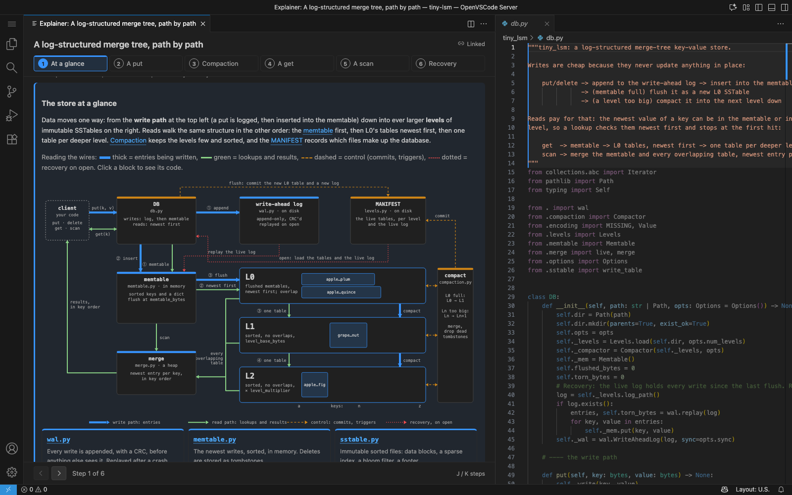
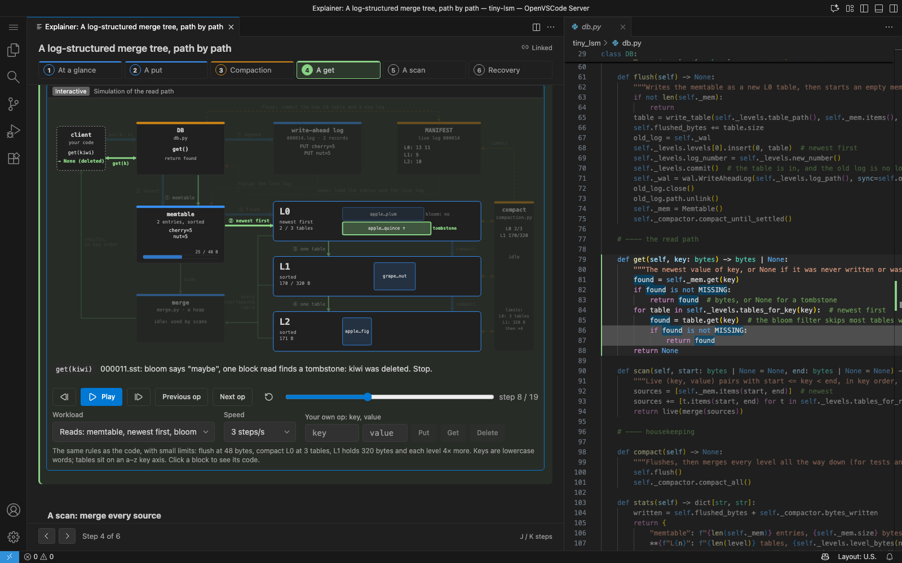
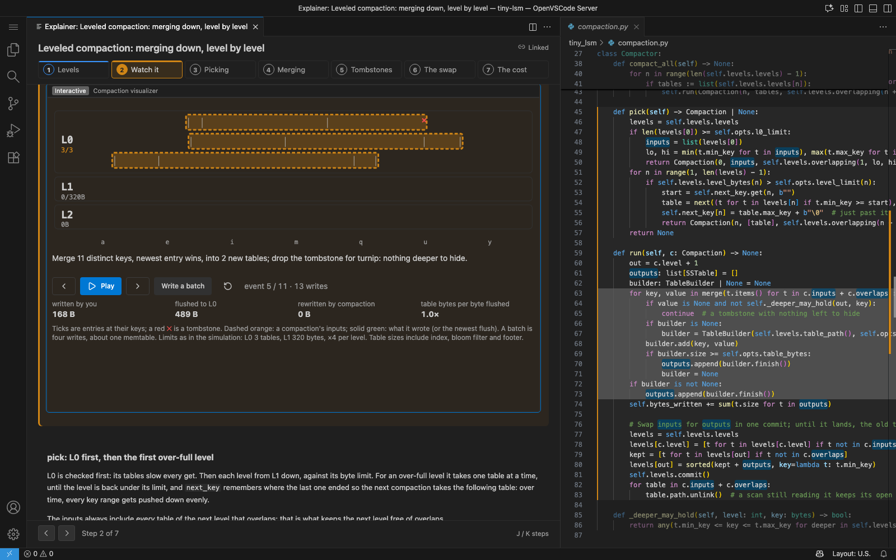
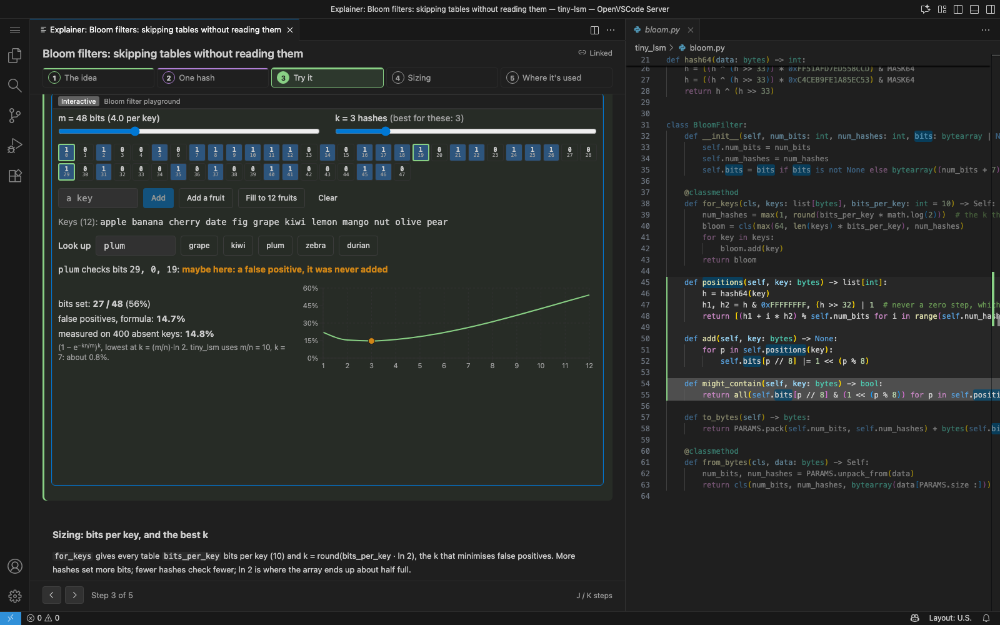
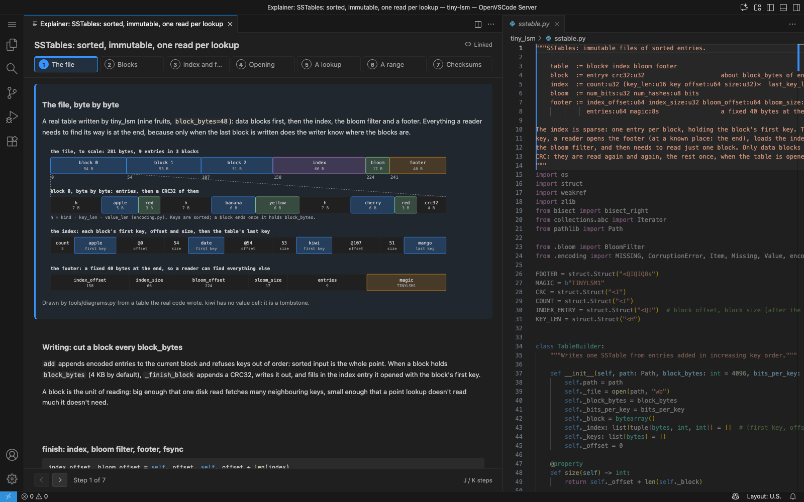
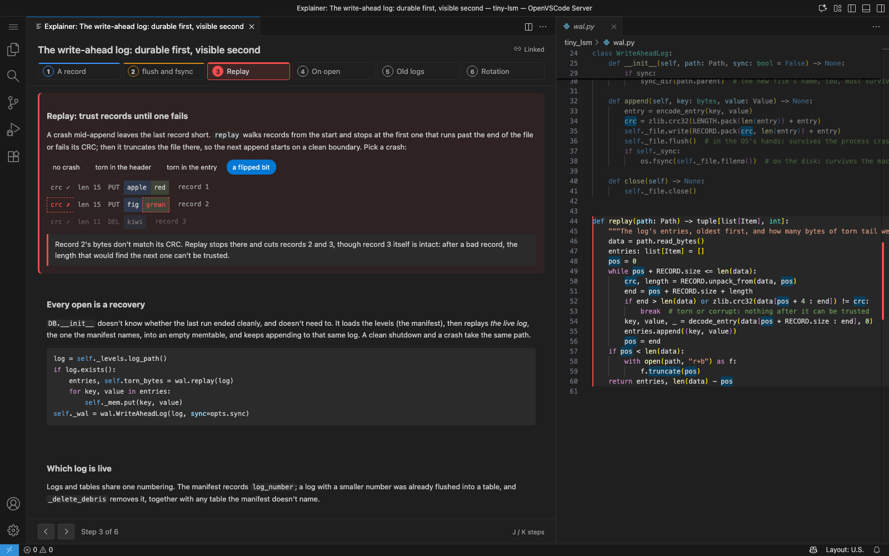

# tiny-lsm: a log-structured merge tree, explained

A small but real key-value store in Python (stdlib only, 3.11+, under 900 lines plus tests), and a set of [Sidestory](../../README.md) explainers that walk through it beside the code: an overview with block diagrams of the write and read paths, one explainer per component, and interactive widgets.



## The code

| File | What it does |
|---|---|
| [`tiny_lsm/db.py`](tiny_lsm/db.py) | `DB`: put, delete, get, scan; flush; recovery on open |
| [`tiny_lsm/wal.py`](tiny_lsm/wal.py) | The write-ahead log: CRC'd records, replay that cuts a torn tail |
| [`tiny_lsm/memtable.py`](tiny_lsm/memtable.py) | The memtable: a dict plus a bisect-sorted key list; tombstones |
| [`tiny_lsm/sstable.py`](tiny_lsm/sstable.py) | SSTables: data blocks with CRCs, a sparse index, a bloom filter, a footer |
| [`tiny_lsm/bloom.py`](tiny_lsm/bloom.py) | Bloom filters: FNV-1a with a Murmur finalizer, double hashing |
| [`tiny_lsm/merge.py`](tiny_lsm/merge.py) | The merge iterator: a heap over sorted sources, newest entry per key |
| [`tiny_lsm/levels.py`](tiny_lsm/levels.py) | The levels and the MANIFEST, committed by atomic rename |
| [`tiny_lsm/compaction.py`](tiny_lsm/compaction.py) | Leveled compaction: L0 → L1, then one table at a time down; tombstone dropping |
| [`tiny_lsm/encoding.py`](tiny_lsm/encoding.py), [`options.py`](tiny_lsm/options.py) | The entry format shared by log and tables; sizes and limits |
| [`tiny_lsm/__main__.py`](tiny_lsm/__main__.py) | A small shell: `python -m tiny_lsm DIR` |
| [`tiny_lsm/tests.py`](tiny_lsm/tests.py) | Tests: crash recovery, torn logs, compaction against a dict, tombstones, snapshots |

```bash
cd examples/tiny-lsm
python3 -m tiny_lsm.tests            # or: python3 -m unittest
python3 -m tiny_lsm /tmp/db          # then: put a 1, get a, load 2000, stats, scan key0100 key0110
```

## The explainers

Open the folder in VS Code with Sidestory installed, run **Sidestory: Open Explainer** and pick **lsm-overview**. Each component card offers a peek at its explainer or a dive into it.

| Explainer | Steps |
|---|---|
| `lsm-overview` | At a glance (block diagram) · A put · Compaction · A get · A scan · Recovery |
| `lsm-wal` | A record (byte layout) · flush and fsync · Replay (pick a crash) · On open · Old logs · Rotation |
| `lsm-memtable` | Two structures · put · Tombstones · In order · When to flush |
| `lsm-sstable` | The file (byte layout of a real table) · Blocks · Index and footer · Opening · A lookup · A range · Checksums |
| `lsm-bloom` | The idea · One hash · Try it (playground) · Sizing · Where it's used |
| `lsm-compaction` | Levels · Watch it (visualizer) · Picking · Merging · Tombstones · The swap · The cost |
| `lsm-merge` | Why a heap · Step by step (a CSS stepper through a real merge) · Refilling · Tombstones |

Three widgets; VS Code asks once per explainer before running them, and each has a static fallback:

- **The simulation** (`lsm-overview`, in the put, compaction, get and scan steps): the overview's block diagram driven by a model of the Python code, step by step. Entries travel to the log and the memtable, flushes add L0 tables, compactions merge them down, gets probe tables through their bloom filters, and a scan pops entries off its heap. The editor highlights the line of Python each step runs. Add your own puts, gets and deletes.
- **The bloom filter playground** (`lsm-bloom`): add keys, look keys up, change m and k; the bits, the false-positive rate (measured and by formula) and a chart of the rate against k.
- **The compaction visualizer** (`lsm-compaction`): levels as rows of tables on an a–z key axis, every entry a tick and every tombstone a cross; write batches and step through flushes and compactions, with the write amplification so far.



## How the pictures stay true to the code

- The widget model ([`.explain/lsm-overview/widgets/model.ts`](.explain/lsm-overview/widgets/model.ts)) follows the Python line for line, with the same byte sizes and the same bloom filter hash. `node tools/model_trace.mjs | python3 tools/check_model.py` runs its scenarios through the real code and compares every table, entry and filter bit.
- [`tools/diagrams.py`](tools/diagrams.py) draws the block diagram (and the geometry the simulation reuses), and draws the SSTable layout, the bloom filter, the compaction and the merge figures from data that tiny_lsm itself wrote. It also finds, by searching the code, which line each simulation step highlights. Rerun it after editing the code: `python3 tools/diagrams.py`.

## Screenshots

| | |
|---|---|
|  |  |
|  |  |
|  |  |
